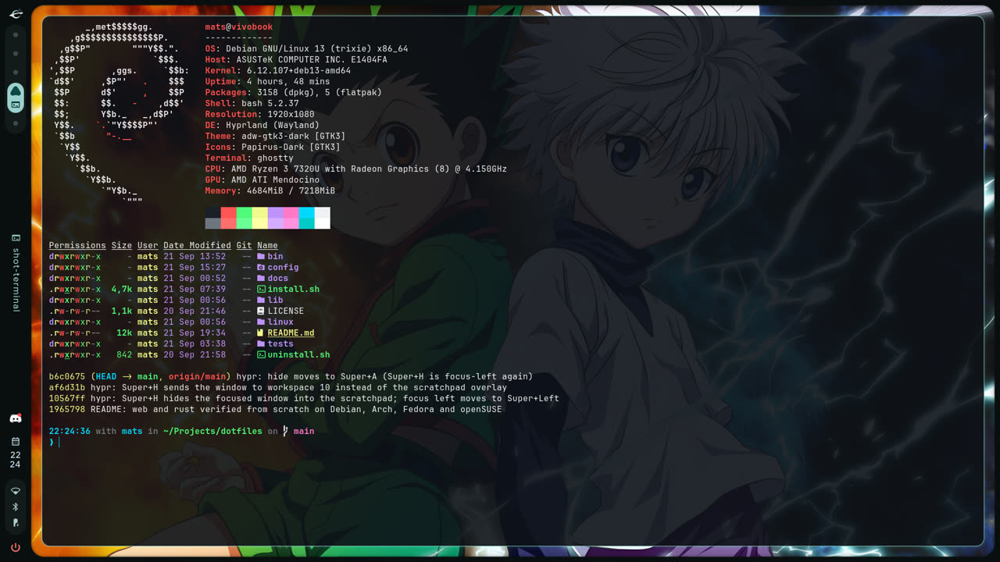
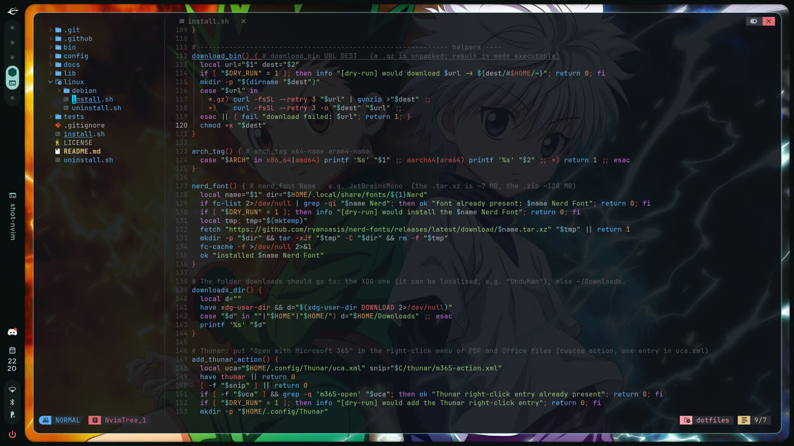
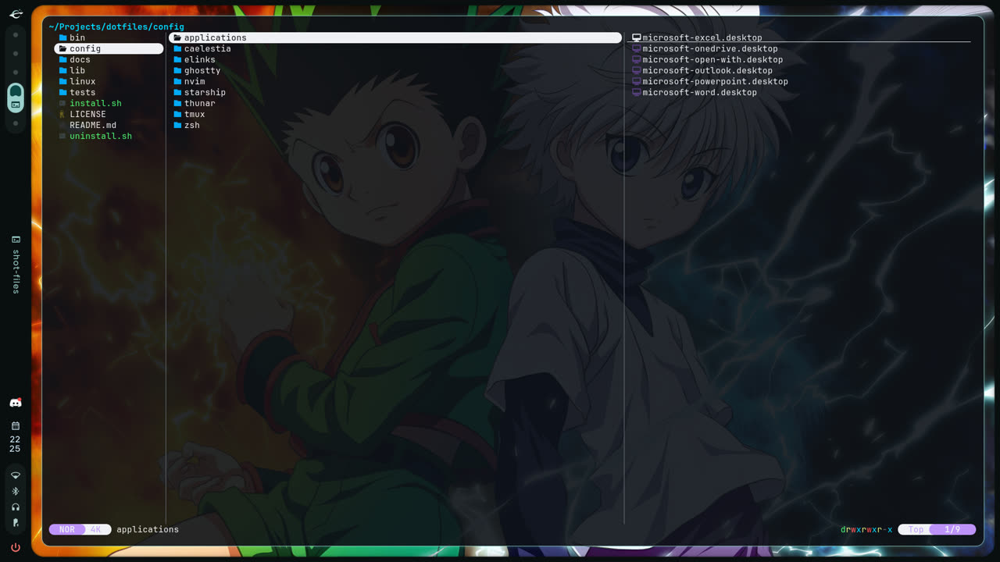
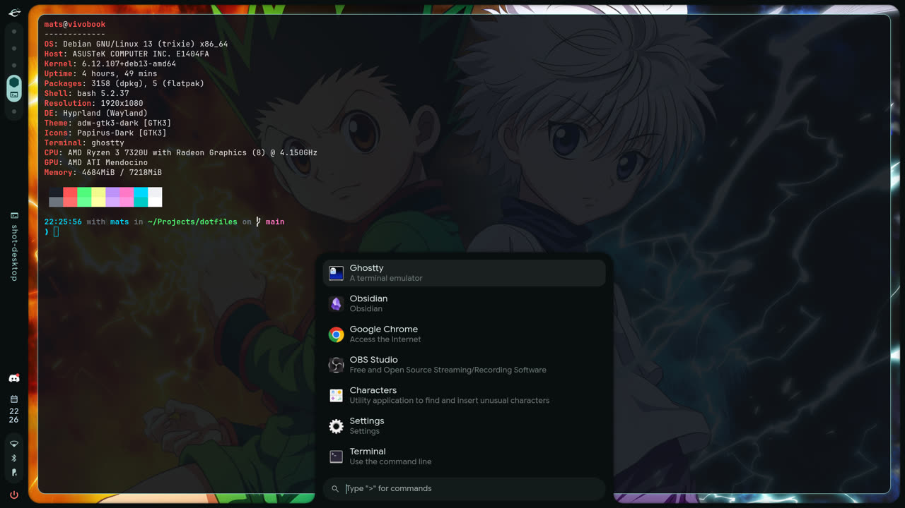
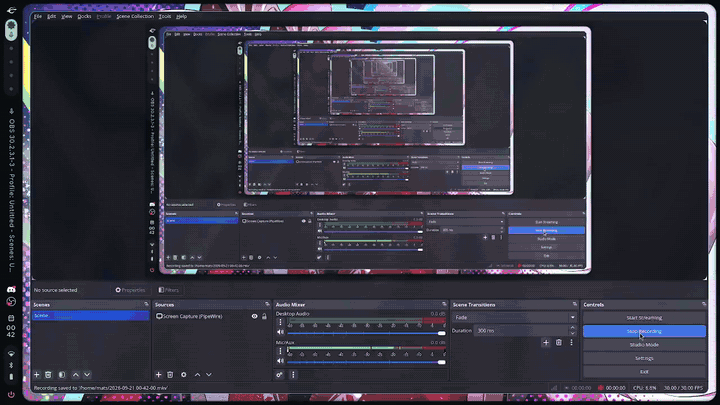

# Dotfiles for Linux (Debian, Ubuntu, Arch, Fedora, openSUSE) and macOS: zsh, tmux, Neovim, Ghostty and Hyprland in one command

[](https://github.com/rhmatzeka/dotfile/actions/workflows/ci.yml)
[](LICENSE)


A one-command **dotfiles installer** for Linux (Debian/Ubuntu, Arch, Fedora, openSUSE) and **macOS** (beta) for a fast
terminal and, on Linux, an optional **Hyprland** desktop with the **Caelestia** shell. A checklist lets you pick only the
parts you want, for example just the terminal setup on a Mac. It sets up **zsh** (Oh My Zsh, starship), **tmux**, **Neovim** with **NvChad** (tree-sitter, LSP),
**Ghostty**, terminal browsers (Browsh, elinks, w3m) and a Dracula + cyan theme. Nothing is overwritten without a
backup, and everything can be undone.

```bash
bash <(curl -fsSL https://dotfiles.rahmateka.my.id)
```

## Preview

<table>
  <tr>
    <th align="center" width="50%">Terminal (Neofetch)</th>
    <th align="center" width="50%">Editor (Neovim)</th>
  </tr>
  <tr>
    <td></td>
    <td></td>
  </tr>
  <tr>
    <th align="center">File manager (Yazi)</th>
    <th align="center">Launcher (Caelestia)</th>
  </tr>
  <tr>
    <td></td>
    <td></td>
  </tr>
</table>

**Desktop demo:**



[Watch the full-quality video (mp4)](docs/preview.mp4)

<!--
  Want a real video player here, like GitHub's own uploads?
  On github.com open this file, click the pencil (Edit), drag your .mp4 into the editor and GitHub inserts a link like
  https://github.com/user-attachments/assets/<id>. Put that link on a line of its own, above the GIF, and commit.
  (It cannot be done with `git push`: GitHub only makes the player for files uploaded through the browser.)
-->

Theme: a Dracula palette with a cyan accent across Ghostty, Neovim (NvChad), tmux, starship and Yazi, on Hyprland with the
Caelestia shell.

## Install

Use `bash <(...)` rather than `curl | bash`: it keeps your terminal attached, so the menu and the `sudo` password
prompt work. **Read a script before you run it.** You can look at this one first:

```bash
curl -fsSL https://dotfiles.rahmateka.my.id | less
```

Every step can be rehearsed without changing anything:

```bash
bash <(curl -fsSL https://dotfiles.rahmateka.my.id) --dry-run --all
```

### The menu

The installer shows a checklist. Type a number to check or uncheck a part, then press Enter. Parts that are already
installed say so and start unchecked. Parts that cannot work on your system are listed separately and **cannot be
selected** (on a Mac: the Hyprland desktop and the Microsoft 365 web-app launchers), so "all" never picks them by
accident. Before anything is installed you get a summary with the big downloads and one more "Continue?".

```
  dotfiles installer - macOS (beta)

  Choose what to install (type a number to check or uncheck it):

    1. [x] base      Homebrew, git, ripgrep, fzf, eza, zoxide and the JetBrainsMono Nerd Font
    2. [x] shell     zsh + Oh My Zsh + starship prompt (installed)
    3. [x] tmux      tmux with a cyan/Dracula theme
    4. [x] nvim      Neovim (NvChad) with tree-sitter parsers and LSP servers
    5. [x] terminal  Ghostty + its config (Vim-style keys, dark theme)
    6. [ ] browsers  Terminal browsers: elinks, w3m
    7. [ ] web       Web development: PHP, Composer, MariaDB, phpMyAdmin (services stay off unless you say yes)
    8. [ ] rust      Rust toolchain via rustup (rustc, cargo, clippy, rustfmt, rust-analyzer)

  Not available on this system (cannot be selected):
     -  desktop   Hyprland + Caelestia desktop (Linux only)
     -  apps      Microsoft 365 web-app launchers, Thunar menu (Linux only; on a Mac install Office from the App Store)

  number check/uncheck  |  a all  |  n none  |  Enter continue  |  q quit
```

The short domain redirects to the script in this repository (see [docs/short-domain.md](docs/short-domain.md)). If it
ever fails, the same script is at
`https://raw.githubusercontent.com/rhmatzeka/dotfile/main/install.sh`.

## Moving to a Mac

On a new MacBook, open **Terminal** and run the same command:

```bash
bash <(curl -fsSL https://dotfiles.rahmateka.my.id)
```

1. If Apple's Command Line Tools are missing, a dialog opens: click **Install** and wait (git and the compiler come
   from there).
2. The checklist appears with the terminal set (`base`, `shell`, `tmux`, `nvim`, `terminal`) already checked. Add
   `web` or `rust` if you want them; the Linux-only parts are shown but cannot be picked.
3. Homebrew is installed first if it is missing (it asks for your password once). Everything else comes from Homebrew,
   so nothing needs `sudo` afterwards.
4. Open **Ghostty** from Spotlight. It starts zsh with the same prompt, tmux, Neovim and colours as on Linux.

Only the terminal setup, without asking: `bash <(curl -fsSL https://dotfiles.rahmateka.my.id) --yes`. Just a few
parts: `... --only shell,tmux,terminal`. The configs are the same files on both systems, so a change you push here
shows up on the other machine after the next install (or `git pull` in `~/.local/share/rhmatzeka-dotfile`).

| Part | Linux | macOS |
|---|---|---|
| `base`, `shell`, `tmux`, `nvim`, `terminal`, `rust` | yes | yes (Homebrew; Ghostty itself is installed too) |
| `browsers` | Browsh, elinks, w3m | elinks, w3m (no Browsh) |
| `web` | PHP, Composer, MariaDB, Apache, phpMyAdmin | PHP, Composer, MariaDB, phpMyAdmin (served with `php -S`, no Apache) |
| `apps` (Microsoft 365 web-app launchers) | yes | no (install Office for Mac instead) |
| `desktop` (Hyprland + Caelestia) | Debian 13 | no |

Your SSH keys, `.env` files and app logins are not part of this repository; copy them over yourself.

## What you get

| Component | Contents |
|---|---|
| `base` | Base packages (git, fzf, ripgrep, eza, zoxide, ...), the JetBrainsMono Nerd Font, and makes sure your Downloads folder exists |
| `shell` | zsh, Oh My Zsh (autosuggestions, syntax highlighting) and the starship prompt |
| `tmux` | tmux with a cyan / Dracula theme |
| `nvim` | Neovim + NvChad, tree-sitter parsers (html, css, js, php, ...) and LSP servers through Mason |
| `terminal` | Ghostty config: dark theme, Vim-style keys |
| `browsers` | Terminal browsers: Browsh (Firefox in the terminal), elinks, w3m. Files you download in elinks and Browsh are saved to your Downloads folder instead of the current directory |
| `apps` | Microsoft 365 web apps (Word, Excel, PowerPoint, Outlook, OneDrive) in their own windows, plus **Open with Microsoft 365** for local files (converts PDFs to .docx, uploads the file to a private folder of your OneDrive through the Microsoft Graph API, using rclone only for the sign-in, then opens it on the web). Double-clicking Word/Excel/PowerPoint files does this; for PDFs (which stay in your PDF viewer unless you agree to change that during installation) use the Thunar right-click entry **Open with Microsoft 365**. A file that is already open in Word online is not uploaded again (OneDrive locks it); the open copy is shown instead, PDF viewer, VLC, GIMP. Pre-selected only when a graphical session is running |
| `web` | Web development: PHP, Composer, MariaDB, Apache, phpMyAdmin. Services are **not** started unless you say yes (Apache listens on port 80); no passwords are set |
| `rust` | Rust through the official rustup installer: stable toolchain, clippy, rustfmt, rust-analyzer |
| `desktop` | Hyprland + Caelestia shell with see-through, blurred panels and a few small patches: Bluetooth lists (bar panel and the pair-new-device page) hide devices that only show a MAC address and show the device type instead; the Bluetooth panel says so when no adapter is found instead of showing dead switches; WiFi password fields get an eye button to show what you typed; text on the transparent panels gets a thin halo so it stays readable on bright wallpapers; notifications that contain HTML, such as Instagram's, show clean text; hibernation at critical battery gets enough free memory to succeed (`/sys/power/image_size` = 0) and the laptop powers off if it still fails, instead of staying on with a black screen (AMD GPUs do not come back from a failed hibernation), plus Caelestia's btop, fastfetch, foot, micro, thunar, zed and fish configs (only where you have none). **Debian 13 only, beta.** Builds Qt 6.11 from source (1 to 2 hours) |

Checked by default: `base`, `shell`, `tmux`, `nvim` and `terminal` (plus `apps` on Linux when a graphical session is
running). `web`, `rust`, `browsers` and `desktop` are only installed when you check them.

## Memory usage

How much RAM does this setup take? Measured once, on the author's laptop: Debian 13, AMD Ryzen 3 7320U, **7 GB RAM**,
Hyprland 0.55.2, on 2026-09-21. The numbers are **PSS** (read from `/proc/<pid>/smaps_rollup`: memory shared between
processes is divided between them, so nothing is counted twice, unlike the RSS column of `top`). They are approximate,
were taken while the machine was in normal use, and will differ on your hardware.

| Part | RAM | Notes |
|---|---|---|
| Hyprland (compositor) | ~100 MB | RSS; PSS could not be read for this process |
| Caelestia shell (bar, launcher, sidebar, notifications) | ~330 MB | `qs` ~303 MB plus six small helpers: the largest single part of the desktop |
| Ghostty | ~100 MB | one process shared by all windows (measured with a few windows open) |
| Audio, portals, Xwayland, polkit | ~60 MB | not from this repository, but the desktop needs them |
| zsh + Oh My Zsh + starship | ~3 MB | per interactive shell |
| tmux | ~9 MB | the server with one session |
| Neovim (NvChad) | ~136 MB | one shell file open with a language server (Node.js) attached; more plugins and servers mean more |
| Firefox for Browsh | ~560 MB | one blank page. Browsh is the heaviest of the terminal browsers; elinks and w3m need only a few MB |

**The whole desktop (Hyprland + Caelestia + terminal + system services) idles at roughly 0.6 GB** before you open anything
else. In practice your applications dominate: at the time of measuring, a browser with many tabs used about 2.3 GB and a
chat app about 0.6 GB, far more than everything in this repository together.

If RAM is tight:

- **Skip `desktop`.** The terminal parts alone (`--only base,shell,tmux,nvim,terminal`) cost tens of megabytes plus Neovim.
- **Skip Browsh** (it needs Firefox) and use elinks or w3m.
- The Microsoft 365 web apps run in a Chrome window, so each open window costs as much as a browser window (hundreds of MB): close them when you are done.
- MariaDB and Apache (`web`) are not started unless you say so. MariaDB's memory use varied too much here (12 to 160 MB) to give a single figure.


## Supported systems

| System | Status |
|---|---|
| Debian 13 (trixie) | All components except `desktop` installed and checked **from scratch in a clean Debian 13**. `desktop`: the package lists are validated; the source build has not been re-run through this script yet (beta) |
| Ubuntu 24.04 LTS, 26.04 LTS | Same components installed and checked from scratch in a clean Ubuntu (earlier revision of the installer). `starship` is not in the 24.04 repositories, so its official installer is used; Browsh is skipped (no `firefox-esr` package) while elinks and w3m are installed |
| Arch Linux (and Manjaro, EndeavourOS, ... via `ID_LIKE=arch`) | Installed and checked from scratch in the official Arch bootstrap image. Only Arch itself was tested. `web` and `rust` also installed and checked from scratch |
| Fedora 44 (and RHEL-likes via `ID_LIKE`) | Installed and checked from scratch in the official Fedora container image. `starship` is not in the Fedora repositories: its official installer is used. Only Fedora itself was tested. `web` and `rust` also installed and checked from scratch |
| openSUSE Tumbleweed | Installed and checked from scratch in the official Tumbleweed image. Leap and SLE were not tested. `web` and `rust` also installed and checked from scratch |
| macOS 13 or newer (Apple Silicon and Intel) | **Beta.** Everything except `desktop` and `apps`, through Homebrew. Checked on every push by GitHub Actions on `macos-latest` with Apple's own `/bin/bash` 3.2: the menu, a dry run of every part, and a real install of `shell`, `tmux`, `browsers` and `rust` followed by `uninstall`. Not yet run by hand on a real Mac; `nvim`, `terminal` (Ghostty) and `web` were only dry-run |
| Alpine, NixOS, Void, Gentoo | **Not supported.** Contributions are welcome (see below) |

`desktop` (Hyprland + Caelestia) is **Debian 13 only** because it depends on `trixie-backports` and on pinned build
versions. On the other distributions it is not offered; install Hyprland from your repositories and follow
[caelestia-dots/caelestia](https://github.com/caelestia-dots/caelestia).

**Laptops with a MediaTek MT7902 (Filogic 310) WiFi/Bluetooth card** (some ASUS Vivobooks): Debian 13's 6.12 kernel
has no driver for its WiFi, and Bluetooth only starts some of the time (`hci0: Opcode 0x0c03 failed: -110`, then
"No default controller available"). The backports kernel supports both. The installer does not change your kernel;
do it yourself with `sudo apt install -t trixie-backports linux-image-amd64 firmware-mediatek` and reboot. The old
kernel stays in the GRUB "Advanced options" menu.

On **Arch**, keep the system up to date (`sudo pacman -Syu`) before running the installer: it installs with
`pacman -S --needed` and does not refresh the package database itself, to avoid a partial upgrade.

Ghostty has no package on Debian, Ubuntu, Fedora or openSUSE: only its config is installed there. On Arch it is
installed from the repositories when available.

### How this was tested

- Real installs into **clean root filesystems** (official images, run in `systemd-nspawn`) as a normal user with the
  final version of the installer: Debian 13, Arch, Fedora 44 and openSUSE Tumbleweed with every component except
  `desktop`, then inspected: tool versions, fonts, Neovim with 18 tree-sitter parsers and 7 Mason packages, the Microsoft
  365 launchers, and `uninstall` (14 links removed each time). Ubuntu 24.04 and 26.04 were verified the same way with
  the previous Debian-only revision. Repeat it yourself with `tests/clean-rootfs.sh` (see below).
- A user who **already has their own config files**: they are backed up, a second install does not back them up
  again, and `uninstall` puts the originals back.
- `--dry-run` for every component, shellcheck, scripted answers for the menu (`tests/menu.sh`), and GitHub Actions
  runs on Ubuntu and macOS for every push.
- Failures are not swallowed: a failed package step fails its component and the installer exits non-zero.

**Not tested:** "Open with Microsoft 365" with a work or school (Microsoft 365 Business) account (it was tested end to end with one personal account: PDF converted, uploaded and opened), the extra Caelestia application configs installed by `desktop`, the `desktop` source build from scratch, the Microsoft 365 web apps opening in a real browser
(the launchers and the installer were tested, not a login), Ghostty itself, any distribution or release not listed
above, and ARM machines.

## Usage

```bash
./install.sh                    # interactive menu
./install.sh --all              # every component this system supports (on Debian 13 that includes desktop)
./install.sh --only shell,nvim  # pick components
./install.sh --dry-run --all    # show what would happen, change nothing
./install.sh --yes              # no questions, use the default answers
./install.sh --list             # list the components
```

Through `curl`, put the options after the command, for example
`bash <(curl -fsSL <url>) --only shell,tmux`.

## Safety

- A file that would be replaced is **moved** to `~/.dotfiles-backup/<timestamp>/`, never overwritten.
- Every symlink it creates is recorded, so `uninstall` only undoes what this installer did.
- `sudo` is used only to install packages and, for `desktop`, to write under `/opt` and `/usr/local`.
- Run it as a normal user, not as root.

## Uninstall

```bash
bash <(curl -fsSL https://dotfiles.rahmateka.my.id/uninstall.sh)
```

The links are removed and your original files come back. Packages, fonts, Oh My Zsh and anything built under `/opt`
are left in place; the list is printed at the end.

## How it works

The top-level `install.sh` detects the OS, fetches this repository to `~/.local/share/rhmatzeka-dotfile`, and hands over to the installer for
that platform: `linux/install.sh`, which uses `lib/pkg.sh` to talk to apt, pacman, dnf or zypper, or `macos/install.sh`,
which uses Homebrew. Both use the same checklist (`lib/menu.sh`) and the same steps for Oh My Zsh, NvChad, elinks and
rustup (`lib/parts.sh`). Everything the Mac runs is kept compatible with the bash 3.2 that macOS ships. Configs live in `config/` and are installed as symlinks, so editing them
in that directory takes effect immediately. Shared helpers (backup, symlinks, dry run) are in `lib/common.sh`.

```
install.sh  uninstall.sh        entry points (OS detection)
lib/common.sh  lib/pkg.sh        shared helpers; pkg.sh maps package names per distribution
lib/menu.sh  lib/parts.sh        the checklist, and the steps Linux and macOS share
linux/                          installer for every family: install.sh, uninstall.sh
macos/                          macOS installer (Homebrew); uninstall.sh reuses linux/uninstall.sh
linux/debian/desktop.sh         Hyprland + Caelestia build (Debian 13 only)
config/                         zsh, starship, tmux, nvim, ghostty, elinks, caelestia
bin/                            small scripts (web, firefox-for-browsh)
docs/                           preview placeholder, how-tos
tests/clean-rootfs.sh           install into a clean Debian/Ubuntu/Arch/Fedora/openSUSE root filesystem and check it
tests/menu.sh                   drive the checklist with scripted answers
```

## Adding another distribution

Everything distribution-specific lives in `lib/pkg.sh`: a case in `pkg_detect` (which `ID`/`ID_LIKE` belongs to which
family), and in `pm_is_installed`, `pm_install` and `pm_names` (the package names that differ). Add the same family to
the detection in the top-level `install.sh`. Use `pkg_need` / `pkg_optional` in components so `--dry-run` and backups
keep working. Pull requests are welcome; please say in the description which system you actually tested on.
`tests/clean-rootfs.sh <debian|ubuntu|arch|fedora|opensuse> <codename>` builds a minimal system, runs the installer in it
as a normal user and checks the result (needs `sudo` and `systemd-container`; `debootstrap` for Debian/Ubuntu, `zstd`
for Arch).

## Keywords

dotfiles, Linux setup script, Debian dotfiles, Ubuntu dotfiles, Arch Linux dotfiles, Fedora dotfiles, openSUSE dotfiles, one-line installer, Hyprland dotfiles, Hyprland rice,
Caelestia shell install, Wayland desktop, NvChad setup, Neovim config, zsh + starship + tmux, Ghostty config,
terminal browser, developer environment, unixporn.

## License and credits

The code in this repository is MIT licensed. The colour palette is [Dracula](https://draculatheme.com) (MIT) with a cyan
accent. These are downloaded during installation and are **not** redistributed here: Oh My Zsh (MIT), the NvChad starter
(Unlicense), Browsh (LGPL-2.1), quickshell and the Caelestia shell/CLI (GPL-3.0, built from source; the fixes are shipped as patches in `config/caelestia/patches/`, not as a copy of upstream files), and the Hyprland
configuration from `caelestia-dots/caelestia` (cloned from upstream).
